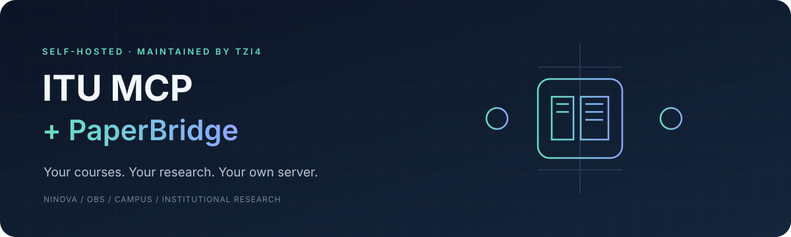
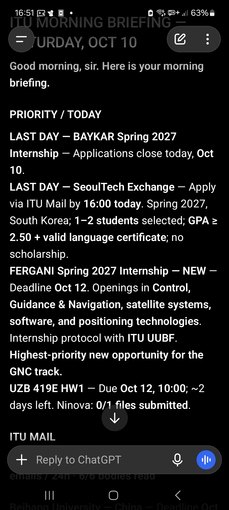
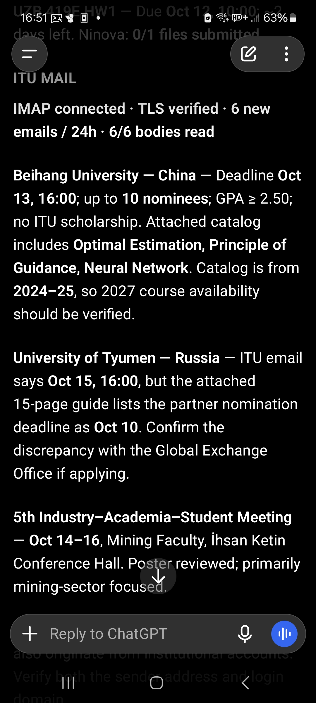
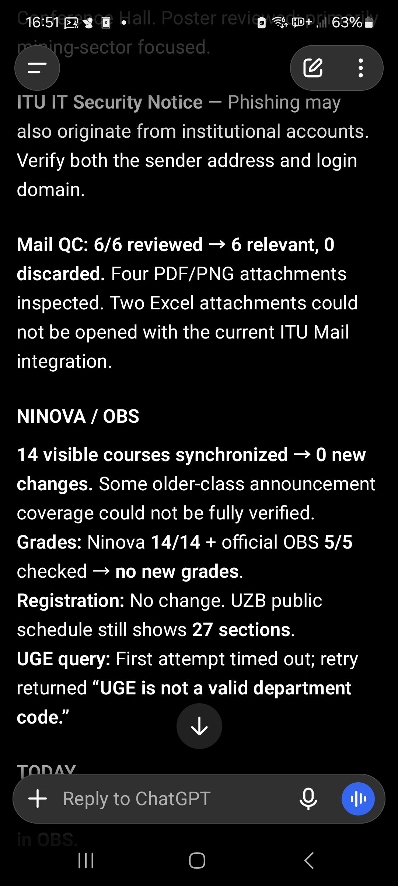
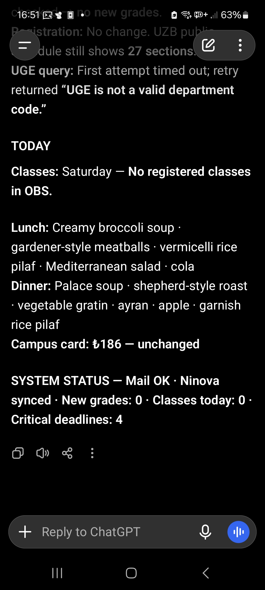
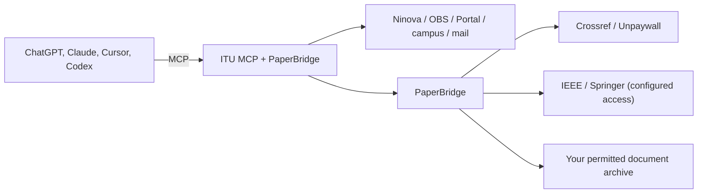

<p align="center"></p>

<p align="center">
  <a href="https://github.com/tzi4/itu-mcp-paperbridge/actions/workflows/tests.yml"></a>
  
  <a href="LICENSE"></a>
</p>

# ITU MCP + PaperBridge

This project is a fork of [ITU MCP](https://github.com/yatuk/itu-mcp) by
[yatuk](https://github.com/yatuk), which I've also contributed to. ITU MCP itself
builds on [Ninova MCP](https://github.com/hikmedit/ninova-mcp) by
[Hikmet Gultekin](https://github.com/hikmedit). It connects your AI assistant to
Istanbul Technical University services such as Ninova, OBS, Portal, ITU Mail and the
library, and runs on your own computer or server.

Both earlier projects are great if you mainly want to read your ITU data. This fork
adds three things that neither of them offers:

1. **Write actions.** Ninova MCP is read-only, and ITU MCP offers a few write actions
   to local clients only. Here your assistant can submit an assignment, send an email,
   open a help ticket and save an OBS registration draft, whether the server runs on
   your computer or on your own server, with whichever assistant you use. Every write
   action asks for your explicit confirmation first.
2. **PaperBridge.** Your assistant can read papers behind publisher paywalls through
   your own university access, not only open-access papers.
3. **A router that saves tokens and time.** Both earlier projects list each
   operation as its own tool; ITU MCP lets you switch whole groups off. Here, instead
   of loading all 114 tool definitions into every conversation, the 82 read-only
   operations are reached through one compact tool, so your assistant sees 33 tools.
   In my tests, this server's share of the first prompt dropped to less than half,
   the model picked the right operation more reliably, and several long, multi-step
   requests finished noticeably faster. The router is still evolving.

   <details>
   <summary>Benchmark</summary>

   **ChatGPT, High effort.** 18 real questions about my own account, one fresh chat
   each, through my remote server.

   | | Every tool | Router |
   |---|---|---|
   | Right operation | 17/18 | 18/18 |
   | Median time | 24.5 s | 25.5 s |
   | Exam calendar, a multi-step question | 96 s | 14 s |
   | Attendance check, a multi-step question | 78 s | 38 s |

   Simple one-tool questions took a few seconds longer with the router. ChatGPT
   does not report token use, so I measured tokens in Claude Code with `claude -p`
   ([script](benchmarks/tool_routing/run_claude.py), Haiku 5.5, high effort): the
   router cut this server's share of the first prompt from about 24k to about 10k
   tokens and the total input of all 18 questions by 19%. Claude Code's own tool
   search does even better there (41% fewer tokens, with every tool), so in Claude
   Code use the full list: `ITU_MCP_TOOL_PROFILE=full`.

   </details>

### Why write actions?

Uploading a finished assignment to Ninova or updating your registration draft
usually means signing in to another site and clicking through it.
Here you ask your assistant instead. It prepares the action, shows you exactly what
will happen and acts only after you confirm, then reports the result so you can
check it.

The same goes for email: your assistant can search your whole ITU mailbox, draft a
message, a reply or a forward, for example to an instructor, with attachments, and send it
after you approve the preview, or save it to your Drafts folder so you can finish it in
webmail. It can also open an ITU help ticket for you: it finds the right unit
and category, fills in the form and submits it once you approve.

### Why PaperBridge?

When you ask ChatGPT, Claude or another assistant to research a topic, it can read
open papers. Most peer-reviewed articles, however, sit behind a paywall. As ITU
students we can read many of them through the university's subscriptions by signing
in with our ITU account. PaperBridge brings that access to your assistant: it
retrieves a paper you are allowed to read through your own institutional access, so
your assistant can read and explain its full text, equations and figures. It
currently works with IEEE Xplore and Springer Nature Link; OpenAthens access, which
opens publishers such as ScienceDirect, is coming soon.

### Why a separate fork?

I contributed to ITU MCP and still do. Some design choices here differ from the
original project, such as offering write actions, so I continue them in this fork.
You can switch write actions off here. If PaperBridge or the router don't interest
you, or you want a strictly read-only server, have a look at
[ITU MCP](https://github.com/yatuk/itu-mcp) and
[Ninova MCP](https://github.com/hikmedit/ninova-mcp) too. This fork keeps the
original Git history, MIT license and attribution.

## What is ITU MCP?

ITU MCP is a small server that lets your AI assistant answer questions about your
courses, grades, schedule and campus life from the real ITU systems, in plain
language.

With your credentials (usually `yourname@itu.edu.tr`), it reads data from
**Ninova** (the course platform), **OBS** (the student information system) and
**Portal**. Without credentials, it still reaches public sources such as course
and final exam schedules, building codes, shuttles, sports facilities,
announcements and the library catalog. It exposes the results as structured tools
over the [Model Context Protocol](https://modelcontextprotocol.io). You ask your
assistant, and it fetches the real data and answers.

| What you need | How ITU MCP answers |
|:---|---|
| "Which assignments are due this week?" | Ninova assignment and due-date tools |
| "Grades or attendance for course X?" | OBS term grades, letter grades and attendance |
| "Transcript, advisor or internship?" | OBS profile, advisor, internship and transcript PDF |
| "What's for lunch today? What's my card balance?" | ITU Portal menu, card and notification tools |
| "When is my final? Are there open seats?" | Public OBS final exam and course schedule tools |
| "When is the next shuttle? When does the pool close?" | Campus service tools |
| "Does the library have this book?" | Public catalog search and copy status |
| "Read my latest emails, tell me which ones matter, and summarize their PDF or image attachments." | Read-only ITU Mail tools and PDF/JPEG/PNG attachment inspection |
| "Read the last email I sent and remind me what I asked for." | Read-only sent-mail listing and message reading |
| "Find the emails from my Linear Algebra course two years ago." | Server-side search across the inbox and sent folder |
| "Reply to my instructor's last email, attach my report and show me before sending." | A previewed draft, sent only after you approve it |
| "My VPN won't connect. Open a help ticket with this screenshot." | Help desk unit, category and form fields, submitted after you approve |
| "Scan Ninova for new assignments. Download any new files, start working through the questions, and send me a draft to review." | Assignment discovery and file download; your AI assistant prepares the draft |
| "Use PaperBridge to read this IEEE or Springer paper through my university access and explain its equations and figures." | DOI lookup, configured institutional retrieval and PDF text/page tools |
| "Download this assignment, prepare a solution, and upload the reviewed file to Ninova after I confirm." | Assignment files and submission tools; uploads must be enabled and require `confirm=true` |

These are requests you can give your AI assistant. ITU MCP provides the university
data and tools; your assistant connects the steps, drafts answers and explains
what it finds. File creation and image understanding depend on your AI client.
For submissions, review the final file and confirm the exact upload. Remote
submissions also need the reviewed file staged in the server's managed upload
folder.

OBS responses can differ between accounts. When results are incomplete, the tools
say so. Verify important academic decisions in the OBS interface itself.

## What does PaperBridge add?

<p align="center"></p>

I've added PaperBridge for searching academic sources, resolving DOIs, reading
full text I have permission to access, and viewing PDF pages as images. **It
runs in the same process as ITU MCP, so it needs no second MCP connection and no
LLM API key.**

| Source | Support |
| --- | --- |
| Crossref | Search for article titles, authors, DOIs and bibliographic metadata |
| Unpaywall | Open-access link discovery once you configure your own contact email |
| IEEE Xplore | Experimental full-text retrieval through a configured browser, with your own institutional access and a permission record |
| Springer Nature Link | Experimental article and book chapter retrieval under the same conditions |
| Your own archive | Texts and PDF pages with a permission record, plus local search |

Wiley is not supported yet, and Elsevier's ScienceDirect will follow with OpenAthens.
Finding the metadata of an article does not mean reading the full article. For
new sources that have an open-access link, use regular web access. PaperBridge
does not start an institutional login or a new PDF download for such sources.

PaperBridge ships with the package, and its research tools are available by
default. The publisher browser and institutional login stay off until you
configure them. Installation does not download a browser or grant permission for
any document. Tool use and page attachments have been verified in ChatGPT. In
Claude and other MCP clients, the core tools work over standard MCP, while page
attachments and automatic continuation depend on client support. See
[PaperBridge setup](docs/paperbridge.md) for details.

## Use cases

### A morning briefing from my server

I run ITU MCP + PaperBridge on my Raspberry Pi, connect it to ChatGPT, and use
a scheduled task for a morning briefing. Instead of checking several sites, I
get my classes for the day, the lunch menu, upcoming assignment deadlines and
the important messages in my inbox together:

> "You have two classes today. Here's today's lunch menu. An assignment is due
> in two days. Six new emails arrived; two need your attention."

Here is a real English briefing from my phone. It brings together priorities,
mail attachment summaries, course updates and the campus menu. Tap any screenshot
to read it at full size.

<table>
  <tr>
    <td width="25%" align="center"><a href="docs/screenshots/morning-briefing-priorities.jpg"></a><br><sub>Priorities and deadlines</sub></td>
    <td width="25%" align="center"><a href="docs/screenshots/morning-briefing-mail.jpg"></a><br><sub>Mail and attachments</sub></td>
    <td width="25%" align="center"><a href="docs/screenshots/morning-briefing-courses.jpg"></a><br><sub>Ninova and OBS</sub></td>
    <td width="25%" align="center"><a href="docs/screenshots/morning-briefing-today.jpg"></a><br><sub>Today on campus</sub></td>
  </tr>
</table>

This example shows my configured setup. The briefing includes
source limitations and incomplete checks; available tools and results depend on
your own configuration and account.

With the server running, I can also open my AI app on my phone and ask a question
while my computer is off. I can check a deadline, read a course file, work through
an assignment or ask PaperBridge about a paper wherever I have a connection.
When submission is configured and my reviewed file is ready in the upload folder,
I can confirm its upload from the same conversation.

For me, an always-on server is the most convenient setup: my phone is already
with me, and I don't need to start my computer first. Scheduling comes from my
AI app or a separate automation setup; ITU MCP supplies the data and tools.

### The same tools while your computer is on

You can also run the server on your own computer and connect a desktop AI client.
While the computer and server are running, ask about your courses, read mail
attachments, review assignments and explore papers in the same conversation.
With remote HTTPS access configured, a compatible AI app on your phone can
connect to that computer too.

Both setups use the same university and research tools; an always-on server only
adds availability while your computer is off.

## Quick start

ITU MCP requires Python **3.11 or later**. Install this fork from source:

```bash
git clone https://github.com/tzi4/itu-mcp-paperbridge.git
cd itu-mcp-paperbridge
python3 -m venv .venv
source .venv/bin/activate
python -m pip install .
itu-mcp --version
itu-mcp --list-tools
```

On Windows, create the virtual environment with `py -3.12 -m venv .venv`, then run
`.\.venv\Scripts\python.exe -m pip install .` and
`.\.venv\Scripts\itu-mcp.exe --list-tools`.

In your MCP client, give the full path to the `itu-mcp` executable inside this
virtual environment. For tools that need credentials, set `NINOVA_USERNAME` and
`NINOVA_PASSWORD` in your own private client or service settings. Public tools do
not need a university password.

**The `itu-mcp` package on PyPI and the older upstream packages are not
distributions of this fork.** Install the current fork from this repository. The
[installation guide](docs/installation.md) includes configuration examples for
Claude Desktop, Cursor and Codex.

## How it works



Local clients connect to `itu-mcp` over stdio. Remote clients such as ChatGPT
need `itu-mcp-remote`, your own HTTPS endpoint, authentication and a tool
allowlist. The [advanced settings](docs/advanced.md) and the
[security guide](docs/security.md) explain the setup.

Each installation serves a single user. It does not separate different users or
document archives that share the same server. This repository does not include
credentials, private emails, PDFs, browser sessions or archive databases. Write
actions are on by default; the [advanced settings](docs/advanced.md) show how to switch
each one off. ITU MCP has no official affiliation with ITU.

## Development

If you use this project and something is missing, or you have an idea that would
make it more useful, [open an issue](https://github.com/tzi4/itu-mcp-paperbridge/issues).
I'd love to hear how you're using it and what you'd like to add. Bug reports
and feature requests are welcome, even if you don't plan to write code.

If you'd like to build it yourself, check the
[contributing guide](CONTRIBUTING.md) and open a pull request against this fork.

```bash
python -m pip install -e .
NINOVA_USERNAME=dummy NINOVA_PASSWORD=dummy python -m unittest discover -s tests -v
```

Base new changes on the `main` branch of this fork and open pull requests against
**tzi4/itu-mcp-paperbridge**. The tests use synthetic data, and live account and publisher
tests run separately. See the [contributing guide](CONTRIBUTING.md).

## Acknowledgements

This project stands on two earlier ones. [Ninova MCP](https://github.com/hikmedit/ninova-mcp)
by [Hikmet Gultekin](https://github.com/hikmedit) was the first open-source,
credential-based MCP server for ITU Ninova. [ITU MCP](https://github.com/yatuk/itu-mcp)
by [yatuk](https://github.com/yatuk) built on it and extended it with many more ITU
services. Thank you both.

Ninova MCP by **Hikmet Gultekin** · ITU MCP by **yatuk** · Fork and PaperBridge by **tzi4** · [MIT](LICENSE)
