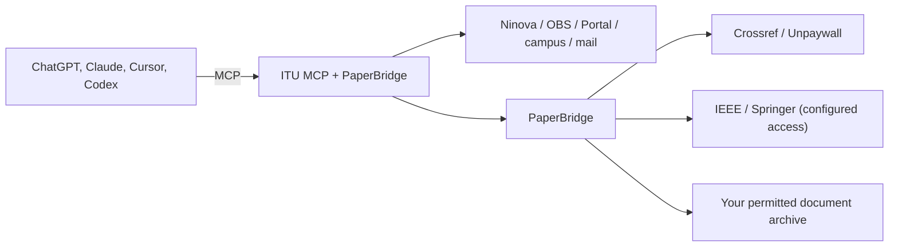

<p align="center"></p>

<p align="center">
  <a href="https://github.com/tzi4/itu-mcp/actions/workflows/tests.yml"></a>
  
  <a href="LICENSE"></a>
</p>

# ITU MCP + PaperBridge

ITU MCP + PaperBridge brings Istanbul Technical University (ITU) courses, campus
services and academic research together in a single MCP connection. It runs on
your own device or server.

This repository is an **independently developed fork of
[yatuk/itu-mcp](https://github.com/yatuk/itu-mcp), maintained by tzi4**. Thanks to
[Hikmet Gultekin / yatuk](https://github.com/yatuk), the creator of ITU MCP. The
fork keeps the existing Git history, the MIT license and the reference to the
original project.

The fork combines OBS reliability fixes, registration planning, course schedule
filters, help ticket details and the PaperBridge integration. The application
sources match the version that ran on the developer's Raspberry Pi on
October 10, 2026, and the [file manifest](docs/pi-source-20261010.json) lists
every file. Each user runs it with their own account and storage.

## What is ITU MCP?

Checking assignments on Ninova, grades on OBS and the dining menu on Portal means
switching between three tabs. ITU MCP is a small server on your computer that
lets you ask about all of them in one place, in plain language.

With your credentials (usually `yourname@itu.edu.tr`), it reads data from
**Ninova** (the course platform), **OBS** (the student information system) and
**Portal**. Without credentials, it still reaches public sources such as course
and final exam schedules, building codes, shuttles, sports facilities,
announcements and the library catalog. It exposes the results as structured tools
over the [Model Context Protocol](https://modelcontextprotocol.io). You ask
Claude, and Claude fetches the real data and answers.

| What you need | How ITU MCP answers |
|:---|---|
| "Which assignments are due this week?" | Ninova assignment and due-date tools |
| "Grades or attendance for course X?" | OBS term grades, letter grades and attendance |
| "Transcript, advisor or internship?" | OBS profile, advisor, internship and transcript PDF |
| "What's for lunch today? What's my card balance?" | ITU Portal menu, card and notification tools |
| "When is my final? Are there open seats?" | Public OBS final exam and course schedule tools |
| "When is the next shuttle? When does the pool close?" | Campus service tools |
| "Does the library have this book?" | Public catalog search and copy status |
| "Show my latest unread email" | Read-only ITU Mail tools |
| "Summarize this PDF" | Download and `read_resource_text` (PDF/DOCX) |
| "Submit my assignment" | Optional upload, requires `confirm=true` |

OBS responses can differ between accounts. When results are incomplete, the tools
say so. Verify important academic decisions in the OBS interface itself.

## What does PaperBridge add?

<p align="center"></p>

PaperBridge adds tools for searching academic sources, resolving DOIs, reading
full text you have permission to access, and viewing PDF pages as images. **It
runs in the same process as ITU MCP, so it needs no second MCP connection and no
LLM API key.**

| Source | Support |
| --- | --- |
| Crossref | Search for article titles, authors, DOIs and bibliographic metadata |
| Unpaywall | Open-access link discovery once you configure your own contact email |
| IEEE Xplore | Experimental full-text retrieval through a configured browser, with your own institutional access and a permission record |
| Springer Nature Link | Experimental article and book chapter retrieval under the same conditions |
| Your own archive | Texts and PDF pages with a permission record, plus local search |

Automatic full-text retrieval from Elsevier and Wiley is not implemented yet.
Finding the metadata of an article does not mean reading the full article. For
new sources that have an open-access link, use regular web access. PaperBridge
does not start an institutional login or a new PDF download for such sources.

PaperBridge ships with the package, and its research tools are available by
default. The publisher browser and institutional login stay off until you
configure them. Installation does not download a browser or grant permission for
any document. Tool use and page attachments have been verified in ChatGPT. In
Claude and other MCP clients, the core tools work over standard MCP, while page
attachments and automatic continuation depend on client support. See
[PaperBridge setup](docs/paperbridge.md) for details.

## Quick start

ITU MCP requires Python **3.11 or later**. Install this fork from source:

```bash
git clone https://github.com/tzi4/itu-mcp.git
cd itu-mcp
python3 -m venv .venv
source .venv/bin/activate
python -m pip install .
itu-mcp --version
itu-mcp --list-tools
```

On Windows, create the virtual environment with `py -3.12 -m venv .venv`, then run
`.\.venv\Scripts\python.exe -m pip install .` and
`.\.venv\Scripts\itu-mcp.exe --list-tools`.

In your MCP client, give the full path to the `itu-mcp` executable inside this
virtual environment. For tools that need credentials, set `NINOVA_USERNAME` and
`NINOVA_PASSWORD` in your own private client or service settings. Public tools do
not need a university password.

**The `itu-mcp` package on PyPI and the older upstream packages are not
distributions of this fork.** Install the current fork from this repository. The
[installation guide](docs/installation.md) includes configuration examples for
Claude Desktop, Cursor and Codex.

## How it works



Local clients connect to `itu-mcp` over stdio. Remote clients such as ChatGPT
need `itu-mcp-remote`, your own HTTPS endpoint, authentication and a tool
allowlist. The [advanced settings](docs/advanced.md) and the
[security guide](docs/security.md) explain the setup.

Each installation serves a single user. It does not separate different users or
document archives that share the same server. This repository does not include
credentials, private emails, PDFs, browser sessions or archive databases. Saving
registration drafts is off by default, and submitting an assignment requires
explicit confirmation. ITU MCP has no official affiliation with ITU.

## Development

```bash
python -m pip install -e .
NINOVA_USERNAME=dummy NINOVA_PASSWORD=dummy python -m unittest discover -s tests -v
```

Base new changes on the `main` branch of this fork and open pull requests against
**tzi4/itu-mcp**. The tests use synthetic data, and live account and publisher
tests run separately. See the [contributing guide](CONTRIBUTING.md).

Original ITU MCP by **yatuk** · Fork and PaperBridge by **tzi4** · [MIT](LICENSE)
